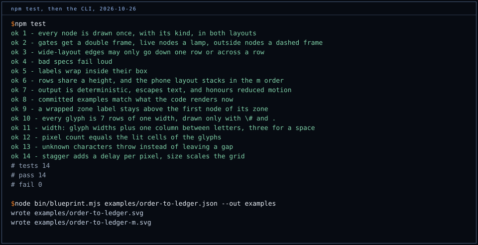

# blueprint-svg

[](https://github.com/cadi27tech/blueprint-svg/actions/workflows/test.yml)

System drawings and dot-matrix wordmarks as standalone SVG. One spec gives two drawings: a column grid for wide screens and a single column for phones. The output has no script and no external reference, so it renders inside a plain `` tag, which is what a GitHub README allows.

It is the drawing kit behind every diagram on [github.com/cadi27tech](https://github.com/cadi27tech), [production-case-studies](https://github.com/cadi27tech/production-case-studies) and the system drawings on [cadi27tech.github.io](https://cadi27tech.github.io), where it started life inside the site build.

<picture>
  <source media="(max-width: 600px)" srcset="examples/order-to-ledger-m.svg">
  
</picture>

## Why

Architecture diagrams in READMEs are usually screenshots of a whiteboard tool: they drift from the system, they cannot be diffed, and at phone width the text is unreadable. Here the drawing is data. A spec is a few lines of JSON in the repo, the SVG is regenerated from it, and a test fails when the committed SVG no longer matches the spec.

The visual grammar is fixed on purpose, so a reader learns it once:

| Frame | Means |
|---|---|
| Dashed | Outside the system: a person, a ledger, a regulator, a third-party API |
| Single | Built: a service, a job, a store |
| Double | A person or a hard check: approval, validation, a gate |
| Bright | A result |
| Orange, with a lamp | Live in production. Orange is used for nothing else. |
| Dotted boundary | A zone: a trust boundary, a runtime, a data residency rule |

## Spec

```json
{
  "title": "Order to ledger, with a human approval",
  "dwg": "DWG EX-001",
  "rev": "REV 1.0",
  "cols": 5,
  "nodes": [
    ["crm",   0, 0, 1, "ext",  "CRM deal", "Closed won, invoice attached"],
    ["draft", 0, 2, 1, "sys",  "Draft invoice", "Every write keyed"],
    ["ok",    0, 3, 1, "gate", "Finance approves", "Signed link"],
    ["sent",  0, 4, 1, "live", "Invoice sent", "Reminded until paid"]
  ],
  "edges": [["crm", "draft"], ["draft", "ok"], ["ok", "sent"]],
  "zones": [["Workflow engine", ["draft"]]],
  "m": ["crm", "draft", "ok", "sent"]
}
```

- **Node:** `[id, row, col, span, kind, label, sub]`. Kinds: `ext`, `sys`, `gate`, `out`, `live`. `sub` is optional and renders as a mono caption.
- **Edge:** `[from, to, label?, flags?]`. Flags: `x` dashed, `d` wide layout only.
- **Zone:** `[label, [ids]]`, a dotted boundary around a group.
- **m:** the node order for the phone layout. On a phone, an edge that skips a node runs in a side channel on the right.

Layout rules are enforced, not suggested. In the wide layout an edge may only run down to the next row or across a row; anything else throws, so a connector can never cross a box. Unknown kinds, duplicate ids, nodes past the last column and zones naming missing nodes all throw too.

## Use

Node 20 or later, no dependencies.

```bash
node bin/blueprint.mjs examples/*.json --out examples
# with your own fonts embedded (they survive inside an )
node bin/blueprint.mjs spec.json --sans InstrumentSans.woff2 --mono IBMPlexMono.woff2
```

```js
import { sheet, pixelWord } from './index.mjs';

const wide = sheet(spec);                  // the column grid
const phone = sheet(spec, { mode: 'm' });  // the single column
const { svg, width } = pixelWord('Adrian Capraru', { size: 6, stagger: 11 }); // 5x7 dot matrix
```

In a README, serve the phone layout below 600 px:

```html
<picture>
  <source media="(max-width: 600px)" srcset="docs/system-m.svg">
  
</picture>
```

Lines draw themselves in once on load, and nothing moves under `prefers-reduced-motion: reduce`.

## Tests



`npm test` runs 14 tests with `node:test`: layout rules, every failure mode of a bad spec, label wrapping inside boxes and above zones, phone ordering, escaping, determinism, reduced motion, the glyph set, and a check that the committed examples match what the code renders now. CI runs them on every push.

## Licence

MIT. Adrian Capraru, [cadi27tech.github.io](https://cadi27tech.github.io).
